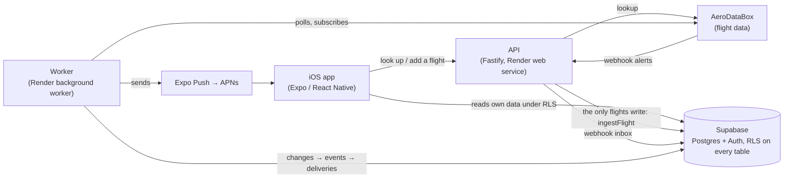

# FlightBuddy

**Group flight tracking for iOS.** FlightBuddy follows everyone in a group who is flying to the
same place and shows every leg, delay and gate change on one screen, with push alerts when
something changes.

Solo flight tracking is a solved problem. FlightBuddy's focus is the group: four friends
converging on one destination from three cities, all on one screen.

> **Status:** private development. Phase 2 (the tracking engine) is complete and running. Phase 3
> (groups) is next, then a TestFlight beta for friends and family. "FlightBuddy" is a working
> name.

---

## What it does today

- **Sign in** with email and password (address confirmed first), Sign in with Apple, or Google.
- **Add a flight** by number and date, typed freely (`DL1234 tomorrow`, `BA 117 Mar 12`):
  - codeshares resolve to the operating flight;
  - a number that flies several legs that day asks you which one.
- **Dashboard** for your next flight: status, gate, terminal, scheduled and estimated times,
  delay and a countdown. Times are shown in the airport's local time with a zone label.
- **Live tracking:**
  - polling on a schedule that tightens as departure nears;
  - provider webhooks inside the alert window;
  - an automatic fallback to polling if the provider's alert credits run out.
- **Push notifications** for cancellations, delays, gate changes, departed, landed and
  diversions, sent to every device you're signed in on. Tapping one opens the flight.
- **Profile** as a "passport":
  - lifetime flights, airports, countries and miles;
  - a frequent-flyer level;
  - "flying with friends" stats;
  - a flight log.

**Coming next (Phase 3):**
- groups with 6-character join codes and owner approval;
- adding a friend's flight before they have an account;
- the group page;
- per-member mutes.

## How it fits together



- **A flight is a shared fact, not a per-user row.** Four friends on one aircraft are one
  `flights` row and one stream of provider calls. Only the worker and the add-flight path write
  to it.
- **The worker** runs a polling loop with leases and a rate limit:
  - change detection writes `flight_events`;
  - a push pipeline fans each event out to every recipient's devices, at least once, with
    receipts;
  - scheduled jobs run inside it: credit balance, subscription reconcile, archiving.
- **Security:**
  - row-level security on every table;
  - the worker connects as a restricted database role, never with the service key;
  - the webhook receiver sits behind a secret URL token, and a gate change or cancellation that
    arrives by webhook is confirmed with a poll before anyone is notified.

The full design (data model, polling ladder, failure modes, security rules) is in
[`docs/PROJECT_OVERVIEW.md`](docs/PROJECT_OVERVIEW.md), the single source of truth for this
project.

## Repository layout

```
flightbuddy/
├── apps/
│   ├── mobile/            # Expo SDK 57 / expo-router iOS app
│   └── api/               # Fastify API: add-flight, lookups, webhook receiver
├── services/
│   └── poller/            # Background worker: polling, webhooks, push, scheduled jobs
├── packages/
│   ├── shared/            # Types, zod schemas, airport-local time helpers
│   └── flight-provider/   # FlightDataProvider interface + AeroDataBox implementation
├── supabase/
│   ├── migrations/        # Schema, RLS and functions (applied in order, never edited)
│   └── tests/             # SQL contract tests (run on a throwaway local Postgres)
├── docs/
│   ├── PROJECT_OVERVIEW.md  # Master design document
│   ├── STATUS.md            # Current state and handoff notes
│   ├── adr/                 # Architecture decision records
│   └── api-samples/         # Captured provider responses used as test fixtures
└── render.yaml            # Render Blueprint (API web service + worker)
```

Each workspace has its own README with the details: [mobile](apps/mobile/README.md),
[API](apps/api/README.md), [worker](services/poller/README.md).

## Tech stack

| Layer | Choice |
|---|---|
| App | React Native + Expo (iOS first), expo-router |
| API | TypeScript, Fastify |
| Worker | TypeScript on a Render background worker, pg-boss for jobs |
| Database and auth | Supabase (Postgres, Auth, row-level security) |
| Flight data | AeroDataBox via RapidAPI, behind a swappable provider interface |
| Push | Expo Push Notifications (APNs) |
| Tooling | npm workspaces, TypeScript end to end, Vitest, ESLint, Prettier |

## Getting started

### Prerequisites

- Node.js **22.12+** and npm
- Xcode with an iOS Simulator, for the app
- A Supabase project, and an AeroDataBox key from RapidAPI, for the backend

You can run the app on its own in **mock mode** with no backend at all (see below).

### Install and configure

```bash
npm ci
cp .env.example .env   # then fill in the values; never commit .env
```

`.env.example` documents every variable: what it's for, which service reads it, and which are
required. Database schema changes live in `supabase/migrations/`.

### Run

```bash
npm run dev -w @flightbuddy/api      # API on http://localhost:3001
npm run dev -w @flightbuddy/poller   # background worker
npm start -w mobile                  # Expo dev server for the app
```

To try the app without a backend, set `EXPO_PUBLIC_MOCK_API=1`: it then serves built-in sample
flights and groups. Changing any `EXPO_PUBLIC_*` value needs a native rebuild. Simulator and
device build steps are in [`apps/mobile/README.md`](apps/mobile/README.md).

### Check

```bash
npm run typecheck            # every workspace
npm test                     # unit tests in every workspace
npm run lint                 # ESLint (the app also has: npm run lint -w mobile)
supabase/tests/run-local.sh  # SQL contract tests on a throwaway local Postgres
```

## Deployment

- **API and worker:** Render, described in [`render.yaml`](render.yaml). Both deploy from `main`.
- **Database and auth:** Supabase. Migrations are applied in order, and generated TypeScript types
  are committed in `packages/shared/src/database.types.ts`.
- **App:** built with Xcode or EAS. TestFlight distribution is planned for the beta.

## Documentation

- [`docs/PROJECT_OVERVIEW.md`](docs/PROJECT_OVERVIEW.md): what the product is, every confirmed
  decision, the data model, the flight-data pipeline, failure modes, security and the build
  phases.
- [`docs/STATUS.md`](docs/STATUS.md): where things stand and what's next.
- [`docs/adr/`](docs/adr/): why the bigger technical decisions went the way they did.

## Working on this repo

- **Small, single-purpose commits,** each one green (typecheck, tests, lint), reviewed and
  security-checked before it is pushed.
- **Never commit secrets.** `.env`, MCP configs and `*.local.json` are git-ignored, and values
  live in Render and local `.env` files only.
- **Change the overview with the code.** If a change contradicts `docs/PROJECT_OVERVIEW.md`,
  update it in the same commit.

## License

No license has been chosen yet, so all rights are reserved by the author.
